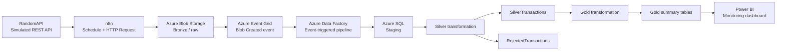

# SecurePay Architecture

SecurePay demonstrates an event-driven Azure data pipeline using simulated payment transaction data.

## End-to-end flow

## Component responsibilities

- **RandomAPI:** supplies simulated transaction records through a REST endpoint.
- **n8n:** periodically calls the API and creates JSON files in Azure Blob Storage.
- **Azure Blob Storage:** stores raw JSON files in the Bronze container.
- **Azure Event Grid:** detects newly created Bronze blobs and starts the ADF event trigger.
- **Azure Data Factory:** reads the Bronze JSON files, copies records into SQL staging, and orchestrates the Silver and Gold procedures.
- **Azure SQL Database:** stores staging, validated Silver, rejected and Gold summary data.
- **Power BI:** presents transaction status, amounts and payment-type insights.

## Important scope notes

- This is a portfolio demonstration using simulated data, not a connection to a real payment gateway.
- The source API is polled on a schedule. Event Grid makes the downstream Blob-to-ADF handoff event-driven; it does not make the external API itself a true streaming source.
- The current ADF pipeline truncates staging and copies files using a wildcard. Incremental file tracking and safe replay handling are future hardening tasks.
- No real fraud decisions or financial actions are performed.

## Suggested diagram asset

A polished architecture image can be added to this folder later as `securepay-architecture.png`. The Mermaid diagram above is the current source-of-truth overview.